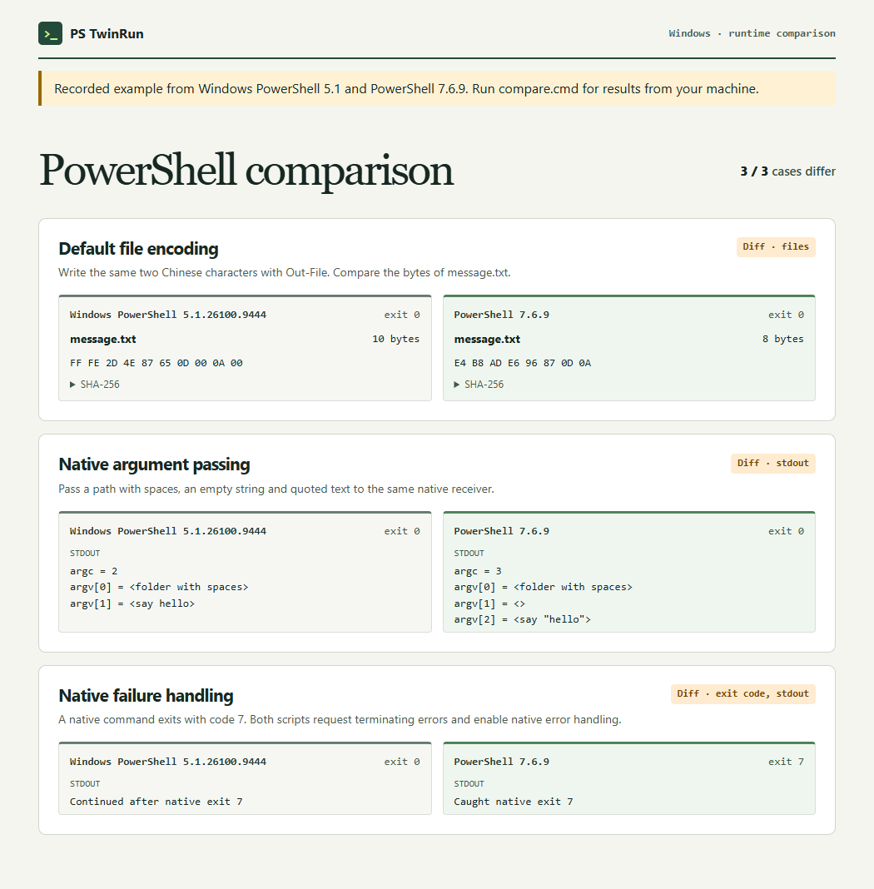

# PS TwinRun

Run the same script in Windows PowerShell 5.1 and PowerShell 7. See exit codes, terminal output, and file bytes side by side.

[Download the ZIP](https://github.com/bobbychina32747/ps-twinrun/releases/latest/download/ps-twinrun-windows.zip) · [中文说明](README.zh-CN.md) · [MIT license](LICENSE)

## Try it

Extract the ZIP, open a terminal in the extracted folder, and run:

```powershell
.\compare.cmd
```

The command runs three local experiments and opens a standalone HTML report in your default browser. A live run needs Windows PowerShell 5.1 and [PowerShell 7.4 or later in the 7.x line](https://learn.microsoft.com/powershell/scripting/install/install-powershell-on-windows). If 7 is missing, the demo opens the clearly labeled recorded report included in the ZIP. No modules, administrator access, or network connection are needed to run the demo.



## What changes?

| Experiment | Windows PowerShell 5.1 | PowerShell 7.6.9 |
| --- | --- | --- |
| Write `中文` with `Out-File` | 10 bytes, UTF-16LE with BOM | 8 bytes, UTF-8 without BOM |
| Pass `'folder with spaces' '' 'say "hello"'` to a native receiver | 2 arguments. The empty value disappears and the inner quotes are lost | 3 arguments. The empty value and inner quotes survive |
| Run a native command that exits 7, with native error handling enabled | Continues and the script exits 0 | Enters `catch` and the script explicitly exits 7 |

The path with spaces survives on both sides. The third case sets both `$ErrorActionPreference = 'Stop'` and `$PSNativeCommandUseErrorActionPreference = $true` on both sides. The latter setting has an effect in modern PowerShell. See the [three short scripts](examples).

## Compare your own script

```powershell
.\compare.cmd -Script ".\my script.ps1" -NoOpen
```

Choose a **trusted, non-interactive script that can run twice**. Each process starts in a different empty working directory. Relative outputs go there. The script keeps its original `$PSScriptRoot` and your Windows permissions, so it can still reach files, services, and the network. A script that uses fixed absolute destinations can write to them twice. Use a small wrapper script if you need to supply arguments or prepare a fixture.

The terminal prints the HTML path. Beside it you'll find `report.json` and the files produced by each shell. By default each run gets a new folder under `%TEMP%\ps-twinrun`. To keep reports elsewhere, add `-OutputDirectory ".\reports"`. To skip opening the browser, use `-NoOpen`.

TwinRun compares the exit code, decoded stdout and stderr, and regular files in the working directory by relative path, length and SHA-256. The report shows up to 32 leading bytes per file. Keep console output small; it is captured in memory. Links and junctions in the output tree produce an error. The comparison covers observable results for the input you ran.

To fail a CI job when the shells behave differently, run the launcher with `-FailOnDifference`. It writes both reports before returning 3 if any case differs.

```powershell
.\compare.cmd -Script ".\my script.ps1" -NoOpen -FailOnDifference
```

| Launcher exit | Meaning |
| --- | --- |
| 0 | The comparison finished. With `-FailOnDifference`, all cases matched. Without it, differences are reported and the launcher still returns 0. |
| 1 | The comparison could not finish. See the terminal error. |
| 2 | A required runtime was missing or unavailable. A built-in demo can still open its recorded preview. |
| 3 | `-FailOnDifference` was set and at least one case differed. See `report.html` or `report.json` for the changed fields. |

Found a migration surprise? A small script that reproduces it in both shells makes a good [example request](https://github.com/bobbychina32747/ps-twinrun/issues).
