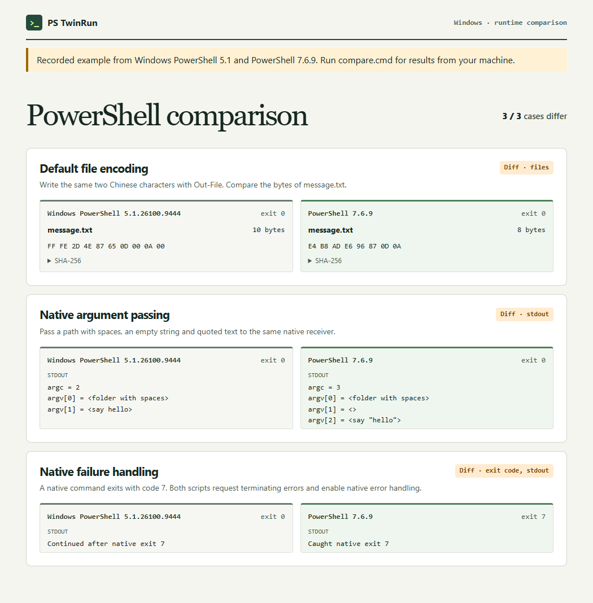

# PS TwinRun

一条命令，把同一个脚本交给 Windows PowerShell 5.1 和 PowerShell 7 各跑一次，并排看退出码、终端输出和落盘文件的字节。

[下载 Windows ZIP](https://github.com/bobbychina32747/ps-twinrun/releases/latest/download/ps-twinrun-windows.zip) · [English](README.md) · [MIT 许可证](LICENSE)

## 试一下

解压 ZIP，在解压后的目录打开终端，执行

```powershell
.\compare.cmd
```

工具会跑三个样例，并用默认浏览器打开本机生成的 HTML 报告。实跑需要 Windows PowerShell 5.1 和 [PowerShell 7.4 或更新的 7.x](https://learn.microsoft.com/zh-cn/powershell/scripting/install/install-powershell-on-windows)。如果电脑缺少 7，演示会打开包内标有“Recorded example”的实测报告。运行样例无需安装模块、管理员权限或联网。



| 实验 | Windows PowerShell 5.1 | PowerShell 7.6.9 |
| --- | --- | --- |
| 用 `Out-File` 写“中文” | 10 字节，UTF-16LE，有 BOM | 8 字节，UTF-8，无 BOM |
| 把带空格的路径、空字符串、带内嵌引号的文字传给同一原生程序 | 收到两个参数，空字符串和内嵌引号丢失 | 收到三个参数，空字符串和内嵌引号均保留 |
| 原生命令返回 7，并显式开启原生错误处理 | 脚本继续运行，最终返回 0 | 进入 `catch`，脚本显式返回 7 |

第二例中，带空格的路径在两边都保留了。第三例在两边都设置 `$ErrorActionPreference = 'Stop'` 和 `$PSNativeCommandUseErrorActionPreference = $true`，后一个设置在新版运行时生效。[查看三个样例](examples)

## 对照自己的脚本

```powershell
.\compare.cmd -Script ".\我的脚本.ps1" -NoOpen
```

选一个**信任、无需交互、可以执行两次**的脚本。每个运行时从各自的空工作目录启动，相对路径生成的文件会留在那里。脚本仍从原位置加载，保留原来的 `$PSScriptRoot` 和当前用户权限；写入绝对路径、访问网络等操作可能发生两次。需要传参或准备输入时，可以写一个小脚本负责调用。

终端会打印报告路径。同一目录有 `report.json` 和两个版本生成的原始文件。每次运行默认在 `%TEMP%\ps-twinrun` 下新建目录，也可以加 `-OutputDirectory ".\reports"` 指定存放位置。`-NoOpen` 适合在终端或 CI 中使用。

工具按退出码、解码后的标准输出和标准错误、工作目录中的文件路径、长度及 SHA-256 判断差异。HTML 会显示每个文件开头最多 32 个字节。终端文本在内存中收集，适合小输出；遇到文件链接或目录联接会报错。结果覆盖本次输入实际触发的行为。

在 CI 中需要让差异触发失败时，加上 `-FailOnDifference`。只要有一项对照出现差异，启动器就会在写完两份报告后返回 3。

```powershell
.\compare.cmd -Script ".\我的脚本.ps1" -NoOpen -FailOnDifference
```

| 启动器退出码 | 含义 |
| --- | --- |
| 0 | 对照完成。使用 `-FailOnDifference` 时表示所有结果一致。默认模式遇到差异也会返回 0，并将差异写入报告。 |
| 1 | 对照未能完成，具体原因见终端错误信息。 |
| 2 | 所需运行时缺失或不可用。内置演示仍可打开随包附带的实测报告。 |
| 3 | 已启用 `-FailOnDifference` 且至少一项对照存在差异。可在 `report.html` 或 `report.json` 中查看具体字段。 |

欢迎用能复现问题的短脚本[提交新样例](https://github.com/bobbychina32747/ps-twinrun/issues)。
